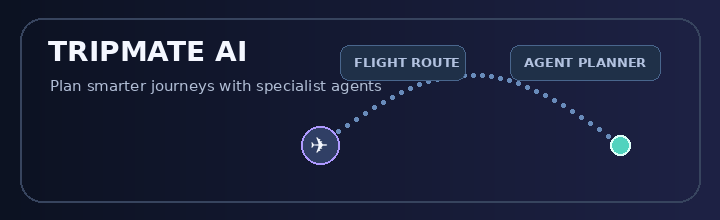
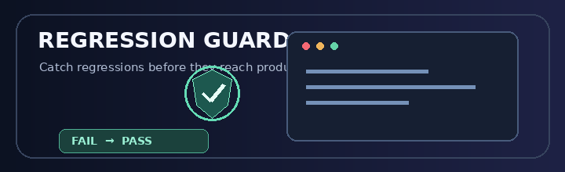
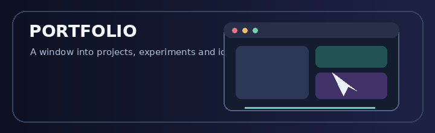

  

&nbsp;&nbsp;

  

<strong>AI-focused developer</strong> building practical software with
<strong>Python, LLMs, RAG, and agentic workflows.</strong>

 
Curious by nature. Engineer by practice.

---

## 👨‍💻 About Me

Hey! I'm an engineering student passionate about building practical AI-powered applications and intelligent systems.

My interests lie at the intersection of **🤖 Agentic AI, 📚 Retrieval-Augmented Generation (RAG), ⚙️ Backend Engineering, and 🧪 Automated Testing.**

I enjoy turning ideas into working software — from designing intelligent workflows and building APIs to testing, containerizing, and deploying applications.

- 💼 **Currently:** Data Science & Machine Learning Intern at Infotact Solutions
- 🛠️ **Building with:** Python, FastAPI, LangGraph, MCP, and Ollama
- 🔍 **Exploring:** Multi-Agent Systems, Guardrails, Human-in-the-Loop (HITL), and Vector Search
- 🎯 **Interested in:** AI Engineering, Backend Systems, and Open-Source Collaboration

---

## Projects

Click any project title to explore the code.

<table>
<tr>
<td width="50%" valign="top" align="center">
  
  <h3>🎧 Lectura AI</h3>
  <strong>YouTube & Lecture Study Assistant</strong>
  
Turns video lectures into timestamped transcripts and searchable knowledge. Ask questions and get grounded answers linked to the exact lecture moments.

  
Python · FastAPI · Whisper · FFmpeg · yt-dlp · ChromaDB · Hugging Face · Mistral AI · Docker

  <a href="https://github.com/nandan91531/lectura-ai"><strong>EXPLORE PROJECT ↗</strong></a>
</td>
<td width="50%" valign="top" align="center">
  
  <h3>✈️ TripMate AI</h3>
  <strong>MCP Multi-Agent Travel Planner</strong>
  
Coordinates specialist agents for flight, hotel, weather, and budget research through a LangGraph supervisor, with human approval before finalizing plans.

  
MCP · LangGraph · LangChain · Groq · FastAPI · PostgreSQL · Docker · External APIs

  <a href="https://github.com/nandan91531/Tripmate-AI"><strong>EXPLORE PROJECT ↗</strong></a>
</td>
</tr>
<tr>
<td width="50%" valign="top" align="center">
  
  <h3>🛡️ Regression Guard</h3>
  <strong>AI-Powered Regression Testing Agent</strong>
  
Generates tests from code diffs and validates them against buggy and fixed workspaces. Its core check is simple: generated tests must FAIL on buggy code and PASS on the fixed version.

  
Python · Ollama · Llama 3.2 · Git · Pytest

  <a href="https://github.com/nandan91531/Regression-Guard"><strong>EXPLORE PROJECT ↗</strong></a>
</td>
<td width="50%" valign="top" align="center">
  
  <h3>🌐 Portfolio</h3>
  <strong>Personal Developer Portfolio</strong>
  
A visual home for selected projects, experiments, and engineering interests bringing my work together in one place.

  
React · Vite · Tailwind CSS

  <a href="https://github.com/nandan91531/Portfolio"><strong>VIEW SOURCE ↗</strong></a>
</td>
</tr>
</table>

---

## Technical Skills

**Languages & Core CS**

 Data Structures & Algorithms · OOP · DBMS · Operating Systems

**Agentic AI & LLMs**

 Multi-Agent Systems · Human-in-the-Loop · Prompt Engineering

**RAG & Vector Search**

**Backend & Data Validation**

 REST APIs · Asynchronous Programming · Input/Output Validation

**ML, Testing & DevOps**

---

## Experience

**Infotact Solutions** · Bengaluru, Karnataka  
*Data Science & Machine Learning Intern (Data Associate L1)*  
`October 2026 – Present`

- Perform data preprocessing, missing-value handling, and exploratory data analysis on structured datasets using Python.
- Working on **Econo Causal: Dynamic Pricing via Double Machine Learning**, exploring causal effects of pricing decisions on demand.
- Apply machine learning and statistical analysis to investigate data patterns and evaluate model results.

---

## Open Source

  
  
<strong>Haystack · deepset</strong>

  
Fixed unintended mutation in <code>InMemoryDocumentStore.update_by_filter</code> and added a regression test.

  <a href="https://github.com/deepset-ai/haystack/pull/13755">READ THE CONTRIBUTION ↗</a>

---

## Highlights

<table>
<tr>
<td align="center" width="33%"><h2>250+</h2><strong>DSA Problems</strong> LeetCode & takeUforward</td>
<td align="center" width="33%"><h2>3rd</h2><strong>INNOVAX 2K26</strong> Global Online Hackathon</td>
<td align="center" width="33%"><h2>8.25</h2><strong>CGPA / 10</strong> B.E. ECE · BIT</td>
</tr>
</table>

---

<h3>Let's build something meaningful.</h3>

  
Build with curiosity. Engineer with intent.
  

